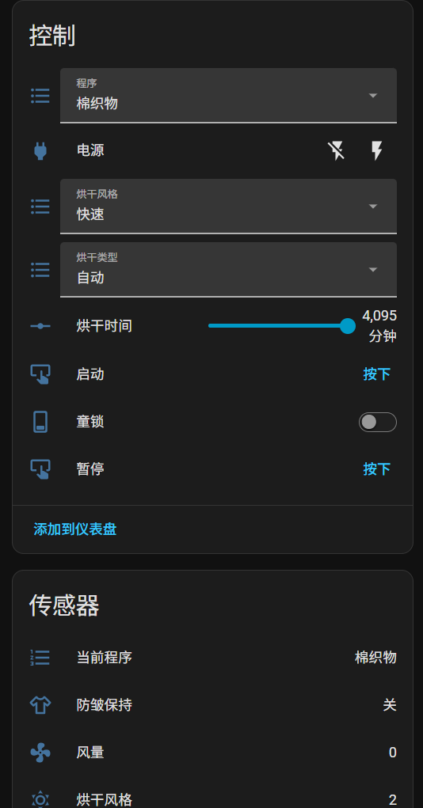

# 松下智能家电 洗衣/烘护 接入（Panasonic Smart China Laundry）

将「松下智能家电」App（中国区）中的**洗衣机**和**烘护机**接入 Home Assistant，支持**状态监控 + 云端控制**。

- **集成域名**：`panasonic_smart_china_laundry`
- **协议**：松下智能家电云接口（app.psmartcloud.com），状态接口 `WDevGetStatusInfoBD158`，控制接口 `WDevSetStatusInfoCommon`（2026-11-21 实机抓包验证）
- **定位**：**监控 + 控制版**（v0.2.0）——传感器 + 二进制传感器 + 电源/童锁开关 + 启动/暂停按钮 + 程序/参数选择 + 数值实体
- **实机验证**：洗衣机 XQG100-L188（品类 0600 / subType 32）、烘护机 FDC-L1026D（品类 0610 / subType 29），2026-11-09 状态实测、2026-11-21 控制实测通过

## 安装

### 方式一：HACS 自定义仓库（推荐，当前即可用）

1. HACS → 集成 → 右上角「⋮」→ **自定义存储库**
1. 粘贴本仓库地址 `https://github.com/lxg20082008/panasonic_smart_china_laundry`，类别选「集成」
1. 在列表中找到 **Panasonic Smart China Laundry** → 下载
1. 重启 Home Assistant，然后按下方「配置」步骤添加

### 方式二：手动复制

1. 将 `custom_components/panasonic_smart_china_laundry` 目录复制到 HA 的 `custom_components/` 下
1. 重启 Home Assistant，然后按下方「配置」步骤添加

### 配置

1. 「设置 → 设备与服务 → 添加集成 → 搜索 Panasonic Smart China Laundry」
1. 输入 App 手机号 → 密码 → 勾选设备

> ⚠️ 云平台为**单点登录**：HA 登录后，手机 App 的会话会被挤下线，需要重新登录 App；反之亦然。

### 启用控制功能

控制依赖设备本体的「远程控制」开关（机身面板上的「远程控制」键，云端字段 `remoteStatus`）。**未开启时云端会拒绝所有控制指令**（集成会显示实体为不可用）。按一下机身「远程控制」键使其常亮即可。

## HACS 商店收录状态

标准 HACS 集成所需的 `hacs.json`、`info.md`、`brand/` 品牌图标均已就绪，Release `v0.2.0` 已发布。官方商店收录申请中：

- [hacs/default#13815](https://github.com/hacs/default/pull/13815) — 集成列表
- [home-assistant/brands#11425](https://github.com/home-assistant/brands/pull/11425) — 品牌图标

两处 PR 合并前，请用上方「自定义仓库」方式安装；合并后即可在 HACS 商店直接搜索下载。

## 支持的设备

| 品类号 | 类型 | 已实测型号 |
|---|---|---|
| 0600 | 洗衣机 | XQG100-L188 |
| 0610 | 烘护机 | FDC-L1026D |

同品类的其他型号大概率可用（协议同源），未实测型号请自行验证。

## 实体清单

烘护机 40 个实体，洗衣机 56 个实体



### 传感器（两机共用）

| 实体 | 说明 |
| --- | --- |
| 运行阶段 | 待机 / 设定中 / 运转中 / 预约中 / 运转终了 / 异常 / 中途关机 |
| 运行状态 | 暂停 / 运行 |
| 当前程序 | 程序名（如「棉织物」「快烘」） |
| 剩余时间 | 本程序剩余分钟数 |
| 总运行时间 / 预约剩余 | 分钟数 |
| 童锁 / 机门 / 远程控制 | 状态 |
| 滤网清洁提醒 | 无需 / 需清洁 |
| 水温 | ℃ |

### 传感器（洗衣机独有）

温度设置、脱水转速、水位、烘干类型、洗涤/漂洗/脱水/烘干时间、智能投放（洗衣液/柔软剂开关、余量、不足提醒）、静音/光动银/水氧泡沫净/离心净水洗/免熨烫/加漂洗/预洗/nanoeX。

### 传感器（烘护机独有）

烘干风格、烘干进度、烘干模式、风量、水箱满提醒、护理剂购买/不足提醒、防皱保持、洗烘联动、清新保持。

### 二进制传感器

运转中、运转终了、异常、预约中、机门开、童锁、远程控制、滤网需清洁；洗衣机：洗衣液/柔软剂不足；烘护机：水箱已满、护理剂不足。

### 控制实体（两机共用）

| 实体 | 说明 |
| --- | --- |
| 开关：电源 | 待机电源开关（`powerStatus`） |
| 开关：童锁 | 面板童锁（`childLock`） |
| 按钮：启动 | 按当前设定启动运转 |
| 按钮：暂停 | 暂停当前运转 |

### 控制实体（洗衣机）

| 实体 | 选项 / 范围 |
| --- | --- |
| 选择：程序 | 31 个本机支持程序（棉织物、混合洗、筒洗净、单脱水……） |
| 选择：水温 | 冷水 / 30~95℃ |
| 选择：脱水转速 | 500~1600r/min |
| 选择：水位 | 少量 / 低 / 中 / 高 |
| 选择：烘干类型 | 自动 / 低温 / 定时 |
| 数字：洗涤时间 | 0~75 分钟（步进 5） |
| 数字：漂洗次数 | 1~3 次 |
| 数字：脱水时间 | 1~15 分钟 |

### 控制实体（烘护机）

| 实体 | 选项 / 范围 |
| --- | --- |
| 选择：程序 | 26 个本机支持程序（快烘、羽绒服、羊毛……） |
| 选择：烘干风格 | 节能 / 快速 |
| 选择：烘干类型 | 自动 / 低温 / 定时 |
| 数字：烘干时间 | 10~120 分钟（步进 5） |

## 自动化示例

```yaml
# 洗衣机完成通知（企业微信）
alias: 洗衣机完成通知
trigger:
  - platform: state
    entity_id: binary_sensor.xi_yi_ji_yun_zhuan_zhong_liao
    to: "on"
action:
  - service: notify.wechat
    data:
      message: "洗衣机洗好了，记得晾晒～"
```

```yaml
# 错峰洗衣：低谷电时段自动启动
alias: 低谷电启动洗衣机
trigger:
  - platform: time
    at: "23:00:00"
condition:
  - condition: state
    entity_id: select.xi_yi_ji_cheng_xu
    state: "棉织物"
action:
  - service: button.press
    target:
      entity_id: button.xi_yi_ji_qi_dong
```

## 项目目录

```
Panasonic Smart China/
├── custom_components/panasonic_smart_china_laundry/   # 集成代码
│   ├── manifest.json
│   ├── const.py          # 常量：程序名映射、状态枚举、控制参数模板
│   ├── token.py          # 设备 token 计算（sha512）
│   ├── api.py            # 登录 / 设备列表 / 状态查询 / 控制下发
│   ├── control.py        # 控制快照构造与下发（状态+缓存合并）
│   ├── config_flow.py    # 配置流（手机号→密码→勾选设备）
│   ├── __init__.py       # 轮询协调器（30 秒）+ 设置缓存
│   ├── sensor.py         # 传感器实体
│   ├── binary_sensor.py  # 二进制传感器
│   ├── switch.py         # 电源 / 童锁开关
│   ├── button.py         # 启动 / 暂停按钮
│   ├── select.py         # 程序 / 参数选择
│   ├── number.py         # 时间 / 次数数值实体
│   └── translations/zh-Hans.json
└── 探测资料/              # 协议逆向原始资料
    ├── device_scan_result.json   # 账号设备扫描结果
    ├── washer_status.json        # 洗衣机 135 字段实机状态
    ├── dryer_status.json         # 烘护机 131 字段实机状态
    └── control_capture.json      # 控制协议抓包样本（8 条实机请求）
```

## 协议要点

- 登录：`UsrGetToken` → 密码 MD5 链 → `UsrLogin` → `ssId`
- 设备 token：`sha512(sha512(MAC后6位_品类_MAC前6位) + '_' + 后缀)`；**后缀必须保持原始大小写**（只大写 MAC 与品类），否则含字母后缀的设备会鉴权失败
- 状态：`POST WDevGetStatusInfoBD158`，header `xtoken: SSID=<ssId>`
- 控制：`POST WDevSetStatusInfoCommon`，body 为**快照式参数**——洗衣机 47 字段 / 烘护机 49 字段，只改目标字段、其余字段带当前值（状态缺失的字段由本地下发缓存兜底）；成功响应 `{"id":N,"results":{"todoId":N}}`
- 启动命令：快照中加 `runingStatus:1 + startType:1 + smartCloudProgram:0`
- 程序枚举：官方 web 控制台 js（collocation.js），已提取到 `const.py`
- 上游参考：[mcdona1d/panasonic_smart_china](https://github.com/mcdona1d/panasonic_smart_china)；其 [PR #12](https://github.com/mcdona1d/panasonic_smart_china/pull/12) 已实现洗衣/烘护/冰箱/旋钮的控制与新增品类，本集成控制 payload 构造已借鉴并实机抓包验证
